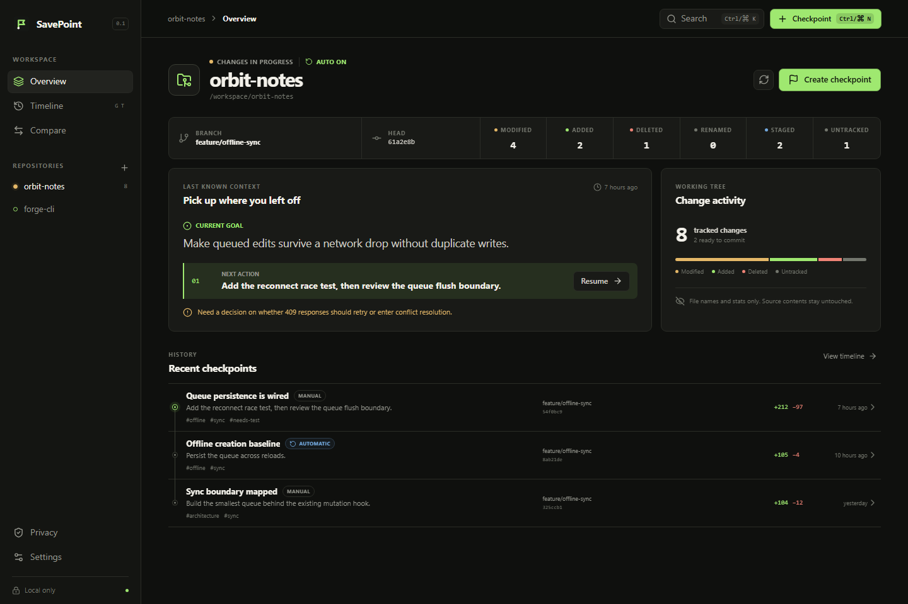
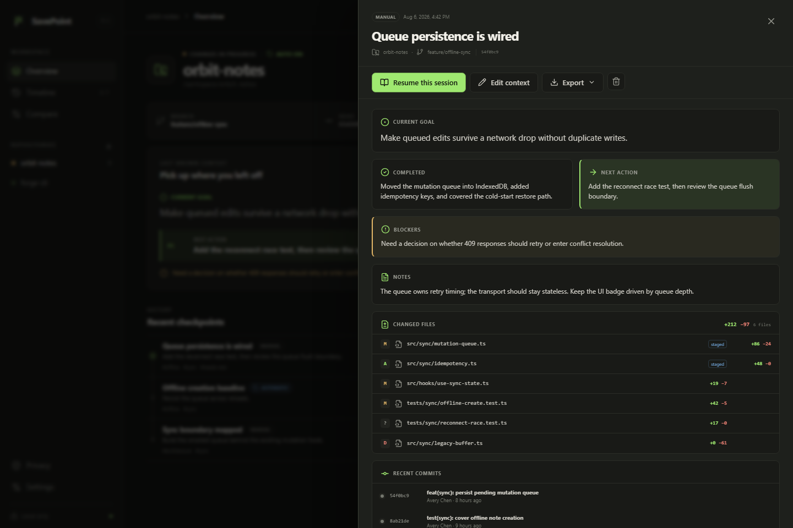
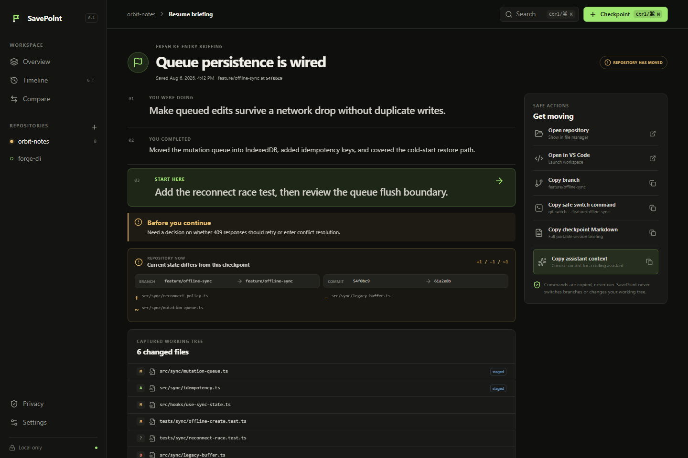
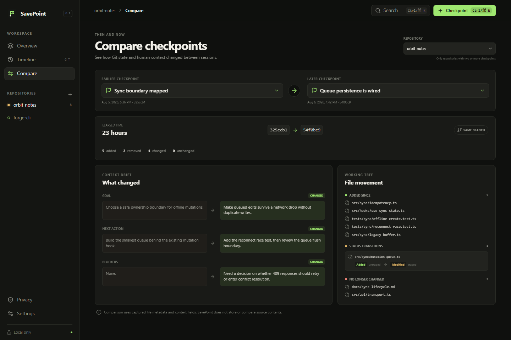

<p align="center">
  
</p>

<p align="center"><strong>Save your development context. Resume without rebuilding it.</strong></p>

<p align="center">
  A private, local-first desktop utility that turns Git working sessions into useful checkpoints.
</p>

<p align="center">
  <a href="https://github.com/ccoop12/savepoint/releases/tag/v0.1.0"><strong>Download v0.1.0</strong></a> ·
  <a href="https://ccoop12.github.io/savepoint/">Project page</a> ·
  <a href="docs/ARCHITECTURE.md">Architecture</a> ·
  <a href="docs/DATA_MODEL.md">Data model</a> ·
  <a href="PRIVACY.md">Privacy</a> ·
  <a href="SECURITY.md">Security</a> ·
  <a href="CHANGELOG.md">Changelog</a>
</p>

SavePoint captures the part of a coding session that Git cannot: what you were trying to do, what
changed, what is blocked, and exactly where to start next. Each checkpoint combines concise human
context with branch, commit, changed-file metadata, diff statistics, and recent commits—without
copying source contents or uploading repository data.



## Why it exists

Branches and commits preserve code history, but they rarely preserve the reasoning around unfinished
work. SavePoint creates a practical re-entry brief before a context switch, so returning to a project
starts with the goal, decisions, blockers, Git state, and next concrete action already in view.

## Core capabilities

- Capture manual or opt-in automatic checkpoints across multiple local Git repositories.
- Record goals, completed work, next actions, blockers, notes, tags, links, and commands.
- Summarize branch, commit, worktree state, changed files, diff statistics, and recent commits.
- Search and filter checkpoint history by repository, branch, tag, and origin.
- Compare two checkpoints from the same repository at the metadata and context level.
- Build a focused resume briefing, including drift from the repository's current state.
- Export portable Markdown and JSON.
- Filter ignored and secret-like paths and redact common token patterns before persistence.

## A 30-second workflow

1. Add a local Git repository with the native folder picker.
2. Describe the current goal and the next concrete action.
3. Create a checkpoint before switching tasks.
4. Return through the resume view or compare checkpoints without changing repository files.







## Engineering highlights

- Local SQLite persistence with explicit migrations, foreign keys, transactions, and atomic writes.
- Metadata-only Git capture with bounded execution and deterministic checkpoint deduplication.
- A temporary, config-isolated Git view that cannot inherit repository hooks, filters, diff drivers,
  credential helpers, submodule commands, alternate object stores, or unsafe `GIT_*` controls.
- Sandboxed, context-isolated Electron renderer with Node integration disabled and hardened fuses.
- Narrow, typed preload methods with Zod validation and bounded inputs at every IPC entry point.
- Unit, integration, deterministic renderer E2E, and real Electron IPC/persistence coverage.
- Reproducible desktop builds with CI, Pages, and unsigned release automation.

## Architecture

The Electron main process owns filesystem, Git, export, and database access. A sandboxed React renderer
can invoke only a small, typed preload API. The persistence layer uses SQLite compiled to WebAssembly
(`sql.js`) and atomically writes the database into Electron's user-data directory, avoiding native ABI
rebuilds across Electron releases. Packaged assets use a private application protocol. Capture,
filtering, comparison, exports, scheduling, and resume summaries remain independently testable.

See [docs/ARCHITECTURE.md](docs/ARCHITECTURE.md), [docs/DATA_MODEL.md](docs/DATA_MODEL.md), and the
[architecture decisions](docs/adr/README.md).

## Privacy and security

SavePoint has no account, cloud backend, telemetry, analytics, advertisements, or AI API. It does not
collect shell history, browser history, clipboard contents, environment variables, editor telemetry,
source-file contents, or complete diffs. Git-ignored and secret-like files are excluded, and likely
tokens in user-authored text are redacted. See [PRIVACY.md](PRIVACY.md) and [SECURITY.md](SECURITY.md).

## Download or run from source

Download [SavePoint v0.1.0](https://github.com/ccoop12/savepoint/releases/tag/v0.1.0) for Windows
x64, macOS universal, or Linux x64. The builds are unsigned, so verify the downloaded file against
`SHA256SUMS.txt` and expect an operating-system security warning on first launch.

To run from source, install Node.js 22.12.0 or newer, npm 10 or newer, and Git, then use the lockfile:

```bash
npm ci
npm run dev
```

## Verification

The fast, noninteractive verification gate runs formatting, linting, strict TypeScript compilation,
unit and integration tests, and a production build:

```bash
npm run verify
```

Release validation also runs the separate coverage and acceptance gates:

```bash
npm run test:coverage
npm run test:e2e
npm run test:electron
```

`test:e2e` exercises the production React components through a deterministic fictional demo adapter.
`test:electron` builds and launches the real Electron application, crosses the preload/IPC boundary,
captures a temporary Git repository, and verifies persistence across restart. Packaging is intentionally
separate from `verify`.

Individual development commands are also available:

```bash
npm run lint
npm run format:check
npm run typecheck
npm test
npm run build
```

Release screenshots use the same production React components with deterministic fictional data:

```powershell
$env:CAPTURE_SCREENSHOTS='1'; npx playwright test tests/e2e/screenshots.spec.ts
```

## Build and package

```bash
npm run build
npm run package
```

`npm run package` creates an unsigned Windows x64 NSIS installer in `release/`. The tag workflow
builds and publishes unsigned Windows, macOS, and Linux artifacts with a verified SHA-256 manifest.
Unsigned builds may trigger Windows SmartScreen or macOS Gatekeeper warnings and are not code-signed.

## Status and limitations

SavePoint v0.1.0 is intended for individual local repositories. It stores metadata rather than source
snapshots, does not restore branches or files, and does not synchronize across devices. Automatic
checkpoints require SavePoint to remain running. VS Code launch requires a supported default
installation path. Repositories using alternate Git object stores are rejected; hydrated Git LFS or
other filtered files can occasionally be reported as modified because SavePoint intentionally refuses
to execute repository-configured filters.

## Roadmap

- VS Code extension and richer IDE handoff
- Encrypted, explicitly enabled diff snapshots
- Workspace bundles and optional cross-device sync
- GitHub issue and pull-request context
- Code signing and an automatic update channel

The local-only privacy model remains the default.

## Contributing

Bug reports, design discussions, tests, and focused pull requests are welcome. Start with
[CONTRIBUTING.md](CONTRIBUTING.md) and follow the [Code of Conduct](CODE_OF_CONDUCT.md). Security issues
should use the private process in [SECURITY.md](SECURITY.md).

## License

SavePoint is available under the [MIT License](LICENSE).
